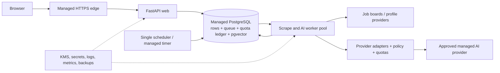

# Architecture Patterns

**Domain:** Hosted, multi-tenant personal job-search SaaS with a retained self-hosted edition
**Researched:** 2026-10-28
**Research confidence:** LOW per the GSD confidence classifier for both `webfetch` and `curated`, despite checking primary project files and official documentation. Treat the architecture below as a reasoned recommendation for v8.0 discovery, not as a cloud, compliance, or capacity commitment.

## Recommended Architecture

Keep Jobot a Python/FastAPI modular monolith for the private beta. Deploy it as a stateless web process plus a separately scaled worker process from the same image. Put state in one managed PostgreSQL database in one region; use PostgreSQL for relational data, usage accounting, and initially vectors through `pgvector`. Keep the current embedded SQLite/Chroma path for self-hosting behind storage adapters rather than introducing a hosted/local runtime fork throughout business logic.

This keeps the beta's operational surface small: one application, one primary datastore, and separate process roles, without requiring Kubernetes, Redis, a separately operated vector database, or organization/team authorization. A managed container platform is preferable to the existing Kubernetes manifests for the first hosted beta; those manifests and Compose files remain useful self-hosted/development targets, not a production SaaS deployment design.

### Component Boundaries

| Component | Responsibility | Communicates With |
|-----------|---------------|-------------------|
| HTTPS edge | TLS termination, request size/time limits, basic abuse throttling; no tenant data decisions | Browser, web process |
| FastAPI web | Authentication, authorization, UI/API requests, enqueue work, present status; no long-running scrape or AI calls in request lifespan | PostgreSQL, provider adapters for short synchronous requests only |
| Tenant/data access layer | Resolve authenticated `user_id`; provide owner-scoped reads/writes; enforce ownership for child records and generated outputs | Web, worker, PostgreSQL |
| PostgreSQL | Authoritative users, sessions, profiles, jobs, settings, applications, task state, and usage ledger; pgvector for hosted retrieval | Web, scheduler, workers, backup service |
| Scheduler | One active scheduling source; enqueue due searches, never execute a scrape inline | PostgreSQL queue |
| Scrape/evaluation workers | Bounded Playwright/scraper and AI concurrency; process only task owner and tenant-scoped records; acknowledge/retry by lease and idempotency key | PostgreSQL, public job sources, AI gateway |
| AI gateway/policy | Reuse existing provider adapters; select allowed stage/model, enforce user and service budgets, record usage, redact safe diagnostics, honor retry hints | Worker, approved managed providers, PostgreSQL quota ledger |
| Hosted vector store | Initially pgvector records in the same PostgreSQL tenant boundary; vectors are private user data and deletable with their source profile | Worker, data access layer |
| Operations | Secret/KMS access, migrations, backup/restore, monitoring, alerting, incident access | Web, worker, PostgreSQL, object storage if added |

### Data Flow

1. The browser authenticates through the HTTPS edge. The application resolves a stable account ID and uses it as the initial personal-workspace/tenant key. Never accept a tenant ID from request payloads as authorization.
2. A request loads or mutates only rows belonging to that account. The request creates a durable task in the same PostgreSQL database and returns a task identifier/status to the UI.
3. A separately deployed worker claims a task in a short database transaction, carries the task's owner ID through every handler, and renews a lease while doing network or model work. It uses idempotency keys for retries and writes outputs only after rechecking ownership.
4. Provider calls pass through the existing adapter boundary, with explicit managed-AI policy, per-user reservation/cap, service-level spend cap, and usage recording. A provider outage or quota rejection remains visible; do not silently fail over to a different provider or send data to a new vendor.
5. The worker stores source/output data and vectors in tenant-scoped PostgreSQL records. Account deletion removes relational rows, vectors, uploaded objects if introduced, and queued tasks, then follows a documented backup-expiry policy.

### Tenancy and Data Boundaries

- **Initial model:** one personal workspace per user, with `user_id` serving as `tenant_id`. Do not add organization membership, team roles, or per-tenant infrastructure in the private beta. Introduce a separate `Workspace` entity only when collaboration is validated; then migrate ownership with an explicit one-user/one-workspace backfill.
- **Shared schema:** use one PostgreSQL database and shared tables, not a database/schema per user. Make owner columns non-null on tenant data, index `(user_id, common_filter)` query paths, and scope uniqueness by owner where records are personal. In particular, the current global `Job.dedup_hash` uniqueness must become tenant-scoped; the current nullable owner fields and installation-wide `AppSettings` must not become accidental SaaS sharing boundaries. See [models.py](../../app/db/models.py), [ownership.py](../../app/db/ownership.py), and [database.py](../../app/db/database.py).
- **Database integrity:** add composite tenant-aware foreign keys/constraints where child and parent ownership could disagree (for example application materials/status history and their job), alongside normal application checks. PostgreSQL documents composite foreign keys and uniqueness constraints as integrity mechanisms; they complement, but do not replace, authorization.
- **Defense in depth:** mandatory owner-scoped data-access functions and cross-account tests are the first line. Evaluate PostgreSQL row-level security before hosted beta or early in beta. If enabled, use a non-owner application role, `FORCE ROW LEVEL SECURITY` where appropriate, restrictive default-deny policies, and set tenant context transaction-locally for every web and worker transaction. Do not rely on RLS when connected as table owner, superuser, or `BYPASSRLS`; all bypass semantics and pooled-connection reset behavior need tests. Keep application authorization even with RLS enabled.
- **Sensitive data and keys:** preserve authenticated encryption for CV/profile secrets and provider credentials, but replace a raw long-lived application master key in environment configuration with a cloud KMS/envelope-key arrangement and tested rotation/recovery. Encrypt backups and restrict operator access. Do not log prompts, CV text, provider keys, session cookies, or raw provider exceptions.
- **AI egress:** managed AI means CV/profile content can leave Jobot's database boundary. Obtain explicit product consent and disclose each provider, endpoint, retention/data-use conditions, region limitations, and the fields sent. OpenAI's current API documentation says API content is not used for model training by default, but abuse-monitoring retention and endpoint application state can still apply; regional storage/processing has eligibility and feature limitations. Do not equate "not used for training" with "not retained" or promise residency before matching both the hosting region and the chosen provider/model/endpoint.
- **Embeddings:** the current local-pinned Ollama embedding route cannot reach a user's workstation from a hosted service. Hosted mode must intentionally select a managed embedding API or a Jobot-operated embedding model in the hosted region, with the same disclosure, quota, and deletion policy. Self-hosted mode can continue to use local Ollama. Do not expose a user's localhost Ollama endpoint to the public service.

### Queue and Runtime Boundaries

Keep the `ScrapeTask` concept, but move its persistence to PostgreSQL and the loops out of FastAPI lifespan. PostgreSQL's `FOR UPDATE SKIP LOCKED` is explicitly suitable for queue-like consumers, so a small private beta can use short transactional claims, owner IDs, leases/heartbeats, retry state, and idempotent handlers without adding a broker. Use a single managed scheduler/periodic trigger to enqueue work; do not start an independent APScheduler in each web replica. Store only task identifiers and bounded non-sensitive parameters in payloads.

At higher throughput, move delivery to a managed queue, but preserve task state and usage accounting in PostgreSQL. Use a transactional outbox or equivalent so a committed user action cannot be separated from its queue message. The queue is delivery, not a second source of truth. Keep scrape and evaluator concurrency independently bounded; browser processes and provider rate limits need separate pools and backpressure.

The current app starts the scheduler and both worker pools in its FastAPI lifespan, and the worker uses SQLite-backed claiming. This is safe only while the deployment remains a single application process/host. Separate process roles before enabling web replicas. See [main.py](../../app/main.py), [worker.py](../../app/queue/worker.py), and [task_queue.py](../../app/queue/task_queue.py).

### Vector Store Choice

**Recommendation for beta:** move hosted vectors into PostgreSQL with `pgvector`, while keeping a narrow vector-store interface so self-hosting retains embedded Chroma. One managed relational service simplifies tenant enforcement, deletion, backups, restore testing, and operational ownership. Start with exact nearest-neighbor queries constrained by `user_id`; the current personal profile/job corpus is a better fit for simple exact search than a premature approximate-index topology.

**Tradeoff:** pgvector requires an extension supported by the selected managed Postgres service and a rewrite/migration of `VectorStore` query/upsert/delete behavior. pgvector's official guidance notes that approximate indexes apply filters after the index scan and that shared approximate indexes can make one tenant affect another tenant's recall/performance; it recommends tenant partitioning or separate tables for isolation. Benchmark tenant-filtered search before enabling approximate indexes, and do not create one physical partition per user without measured need.

**Alternative:** Chroma Cloud preserves more of the Chroma API and documents tenant-level isolation, but region options and product-specific retention, auth, quotas, backup/export, and deletion guarantees must be checked against the selected launch region. Do not put an unauthenticated self-hosted Chroma server on a public network: current Chroma server docs state built-in auth implementations are no longer shipped in Chroma 1.0. If self-hosting Chroma as a separate server, keep it private and put an authenticated service boundary in front of it. Do not share the current embedded Chroma directory between replicas or hosts.

### Migration Sequence

1. **Resolve product/security gates:** choose the beta geography and provider based on user cohort, legal/privacy review, managed-AI data handling, provider budget, and support coverage. Define data export/deletion and backup-retention behavior before ingesting real CVs.
2. **Harden tenant invariants on the current stack:** audit every model, route, background task, vector operation, export, settings path, and delete path. Make tenant ownership explicit/non-null for SaaS data; fix global dedup uniqueness; add tenant-aware constraints and adversarial two-account tests. Preserve the existing careful legacy backfill only as a self-host migration path, never guess ownership in a multi-account hosted import.
3. **Introduce versioned migrations:** replace `create_all` and startup `ALTER TABLE` migrations with Alembic/versioned schema changes, run once as a deployment job, and support expand/migrate/contract changes. Maintain SQLite support for the self-hosted edition.
4. **Move hosted relational state:** take a verified SQLite backup, migrate schema and account-owned rows to PostgreSQL, validate counts/foreign keys/ownership and encrypted-field decryption, then cut over with writes paused. Keep a tested rollback snapshot; avoid indefinite dual writes. Separate installation defaults from account settings.
5. **Move vectors and verify parity:** export/rebuild Chroma vectors into tenant-scoped pgvector (or a validated managed Chroma tenant) using deterministic IDs. Run shadow queries and compare expected neighbors, tenant filters, and deletion behavior before switching reads. Keep re-embedding possible because vectors are rebuildable derived data.
6. **Split runtime and add operations:** run one web role, a separate worker role, and one scheduler trigger; add KMS-backed keys, provider quota ledger, rate limits, dashboards/alerts, encrypted backups, restore drills, and an incident runbook. Only then add replicas or a separate queue based on measurements.

## Patterns to Follow

### Pattern 1: Tenant Context at the Data Boundary

**What:** Resolve the owner from the authenticated principal once per request/task and pass it explicitly into repository/service operations. Use owner-scoped queries for both record lookup and mutation; child access must verify the parent is owned by the same tenant. For RLS, set the same ID transaction-locally.

**When:** Every table, vector collection/index, job payload, cache key, generated artifact, export, and deletion path that contains user-derived information.

**Example:** `select(Job).where(Job.id == job_id, Job.user_id == current_user.id)`; for linked records enforce a `(user_id, job_id)` relationship rather than trusting a supplied `job_id` alone.

### Pattern 2: Durable Queue, At-Least-Once Handler

**What:** Commit a bounded task record, claim with a lease, process outside the HTTP request, then commit results and completion. Assume a worker may crash after an external side effect, so make writes idempotent and avoid duplicate provider spend where possible.

**When:** Scraping, profile extraction, scoring, embeddings, and material generation.

**Example:** Postgres `SELECT ... FOR UPDATE SKIP LOCKED` to claim a short batch, then release the transaction before browser/provider I/O. Use a stable idempotency key per tenant/task stage.

### Pattern 3: Quota Reservation Before Managed AI

**What:** Atomically reserve a per-user request/token/cost budget before provider invocation; record the actual usage afterward and release/settle the reservation on failure. Enforce a separate global provider hard cap, apply bounded retries honoring `Retry-After`, and expose exhausted quota as a clear user-visible state.

**When:** Every managed AI stage, including embeddings. Provider organization/project limits do not enforce Jobot's individual user plans.

**Example:** Usage ledger rows keyed by tenant, provider, model, stage, and billing window; keep prompt/content out of the ledger.

### Pattern 4: One Authoritative Store, Replaceable Adapters

**What:** Keep SQLModel domain services and provider adapters, but isolate database/vector implementations behind narrow interfaces. Hosted Postgres is authoritative; self-host SQLite/Chroma remains a supported adapter combination. Treat vectors as derived data that can be rebuilt from source records.

**When:** Preserving self-hosting without forcing hosted runtime limitations into every call site.

### Pattern 5: Single-Region First, Explicit Egress

**What:** Deploy app, relational data, vector data, backups, logs, and worker in one selected region. Enumerate outbound destinations for job scraping and AI providers; never imply that the database region alone controls all processing/residency.

**When:** Until actual user geography, legal obligations, provider regional support, and operating budget justify more regions.

## Anti-Patterns to Avoid

### Anti-Pattern 1: Shared SQLite/Chroma Filesystem Behind Replicas

**What:** Mount one SQLite WAL database or embedded Chroma persistence directory into multiple hosted hosts/replicas.

**Why bad:** SQLite WAL requires processes on one host and permits only one writer. Embedded local vector storage does not create a safe distributed database. This creates lock, consistency, backup, and availability hazards.

**Instead:** Managed PostgreSQL for hosted state; one process-local/private persistent volume for self-hosting; use a separate authenticated vector service only if benchmarks justify it.

### Anti-Pattern 2: Relying on Frontend IDs or RLS Alone

**What:** Trust posted `user_id`, filter only at the UI, or assume RLS protects access while connecting as the table owner.

**Why bad:** A missed endpoint/task/vector filter can expose another account. PostgreSQL owners and privileged roles bypass RLS by default, and uniqueness/FK checks bypass row policies.

**Instead:** Derive tenant from auth, scope every query and mutation, use tenant-aware constraints, run cross-account tests, and configure/test a non-owner RLS role if RLS is adopted.

### Anti-Pattern 3: Long Work in Web Lifespan or Request Background Tasks

**What:** Keep APScheduler and scrape/evaluator loops in every FastAPI web replica, or perform Playwright/LLM work after responding in the same server process.

**Why bad:** Replicas duplicate schedules, deploys interrupt work, CPU/memory is coupled to request availability, and long tasks lack durable claim/retry semantics.

**Instead:** Separate web, scheduler trigger, and worker roles around durable tasks.

### Anti-Pattern 4: Public Single-Node Chroma With Metadata Filters as Authorization

**What:** Expose self-hosted Chroma directly and rely on a caller-supplied tenant metadata filter.

**Why bad:** Current self-hosted Chroma 1.0 docs state built-in authentication is not shipped; application-controlled filters are not a service identity or a security boundary.

**Instead:** Use pgvector under the application tenant boundary, Chroma Cloud with validated tenant authentication, or private Chroma behind a trusted authenticated gateway.

### Anti-Pattern 5: Treating Provider Policy as Per-User Quota or No Retention

**What:** Assume provider rate limits enforce Jobot user quotas, or promise that CVs are never retained because a provider does not train on API data.

**Why bad:** Provider limits may be organization/project/model scoped; abuse logs and specific API features can retain data, and residency support varies by endpoint/model/region.

**Instead:** Enforce app-owned quota/spend policy and disclose the exact provider, endpoint, data flow, retention controls, and limitations.

### Anti-Pattern 6: Build the Cloud Stack Around Kubernetes by Default

**What:** Turn the current single-replica NodePort/PVC manifests into a public cluster baseline before beta demand requires it.

**Why bad:** It adds cluster operations, secrets, ingress, storage, and release machinery while leaving the current SQLite and in-process workers as the real scaling blockers.

**Instead:** Start on a managed container runtime with managed Postgres and cloud-native secrets/backup; revisit Kubernetes if workload placement, portability, or scale requires it. Never commit real values in the current `k8s/secrets.yaml` template.

## Scalability Considerations

| Concern | At 100 users | At 10K users | At 1M users |
|---------|--------------|---------------|--------------|
| Web/API | One small managed web deployment; stateless requests; health/readiness separated from dependency deep checks | Add web replicas behind managed HTTPS; pool-size and connection limits tuned against DB capacity | Partition by traffic/region only after measured load; consider regional cells and tenant routing |
| Relational data | One managed Postgres primary, automated encrypted backups and restore drill | Increase instance/IOPS, add read replicas only for measured read load; inspect slow queries and tenant indexes | Tenant-aware partitioning/cells or sharding, independent of application process scaling; requires migration and operations investment |
| Jobs | Postgres queue with one worker deployment and bounded scraper/evaluator pools | Scale worker replicas by queue age and provider budget; add managed queue plus outbox if DB contention or queue throughput is material | Shard/partition queues by tenant/work type, separate scraping and AI execution fleets; maintain fairness and per-tenant concurrency limits |
| Vectors | pgvector exact search with tenant filter; measure recall/latency | Benchmark pgvector filtered search; use indexes/partitioning only with recall tests, or move to managed Chroma if measured vector load justifies another service | Dedicated distributed vector service or partitioned vector cells with per-tenant isolation, independent backup/restore and deletion guarantees |
| AI cost/limits | App-owned monthly/daily quota, concurrency caps, global spend alarm/hard cap | Budget and rate-limit by provider/model/tenant; multiple approved providers only with explicit data policy and user disclosure | Provider-level capacity agreements, regional provider routing, abuse/cost anomaly detection, and automated budget controls |
| Operations | Automated backups, tested restore, structured logs, alerting for worker failures, queue age, DB health, AI spend | On-call rotation, SLOs from beta evidence, incident exercises, capacity dashboards, secret rotation automation | Regional failover/cells, formal DR objectives, tenant export/deletion automation, security/compliance program tied to chosen markets |

**Proposed scale triggers (starting guardrails, not promised SLOs):** move beyond the single Postgres queue when queue wait p95 exceeds the user-facing target for a sustained period or queue writes materially contend with interactive traffic; scale the worker fleet when queue age grows despite safe provider/API concurrency; increase database capacity or tune queries when sustained CPU/IO, connection-pool saturation, or interactive p95 latency breaches agreed beta budgets; consider a dedicated vector service only when representative tenant-filtered recall/latency or index resource use fails a documented benchmark. Define numeric budgets after private-beta measurements and provider pricing are known.

## Open Decisions

- Hosting provider, managed container service, launch country/region, and data-processing locations.
- Whether one-to-one user ownership is sufficient for beta, or whether a `Workspace` table is needed before launch; teams remain out of scope.
- Whether hosted vectors use pgvector (recommended default) or a managed Chroma tenant, including managed PostgreSQL extension availability and vector data deletion/export/backup terms.
- Hosted embedding model and operator: managed provider versus Jobot-operated model; privacy disclosure, region, performance, and per-user cost.
- Managed AI provider/model allowlist, retention terms, eligibility for provider data controls, quota units, monthly cap, and over-quota UX.
- Whether PostgreSQL RLS is in the first hosted release; if yes, define role grants, transaction-local context, migration coverage, and bypass tests.
- Applicable privacy/security obligations, data subject export/deletion, retention periods, incident notification/support model, numeric SLO/RPO/RTO, and audit requirements. No certification or residency promise is justified yet.
- Whether hosted scraping of each target source is contractually and operationally appropriate, plus per-user frequency and outbound egress controls.
- When a broker, separate vector service, multiple regions, billing, BYO keys, or team workspaces become justified; decide from private-beta evidence, not assumed user counts.

## Sources

Official documentation checked on 2026-10-28. The GSD source classifier rated `webfetch` LOW; the links below are primary sources, but source-confidence limits remain noted above.

- PostgreSQL Row Security Policies: https://www.postgresql.org/docs/current/ddl-rowsecurity.html
- PostgreSQL Constraints and Composite Foreign Keys: https://www.postgresql.org/docs/current/ddl-constraints.html
- PostgreSQL `SELECT` locking and `SKIP LOCKED` for queue-like consumers: https://www.postgresql.org/docs/current/sql-select.html
- PostgreSQL Backup and Restore: https://www.postgresql.org/docs/current/backup.html
- SQLite Write-Ahead Logging: https://www.sqlite.org/wal.html
- FastAPI Deployment Concepts: https://fastapi.tiangolo.com/deployment/concepts/
- FastAPI Background Tasks and their heavy-work caveat: https://fastapi.tiangolo.com/tutorial/background-tasks/
- Chroma Architecture Overview (deployment modes and tenant model): https://docs.trychroma.com/reference/architecture/overview.md
- Chroma Distributed Architecture: https://docs.trychroma.com/reference/architecture/distributed.md
- Chroma Cloud regions and deployment: https://docs.trychroma.com/cloud/getting-started.md
- Chroma self-hosted server configuration and legacy auth notice: https://docs.trychroma.com/reference/server-env-vars.md
- pgvector official project documentation (indexing and multitenancy tradeoffs): https://github.com/pgvector/pgvector
- OpenAI API data controls and regional limits: https://developers.openai.com/api/docs/guides/your-data
- OpenAI API rate limits and user-level quota guidance: https://developers.openai.com/api/docs/guides/rate-limits
- Kubernetes Secrets security guidance: https://kubernetes.io/docs/concepts/configuration/secret/
- Kubernetes Deployments: https://kubernetes.io/docs/concepts/workloads/controllers/deployment/
